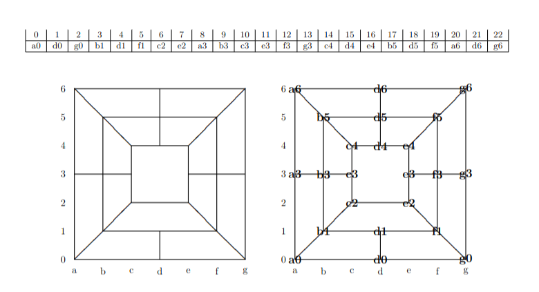

# CS4346 Morris Game Variant AI 

## Overview
Nine men's morris is a centuries old strategy game where two players place and move pieces on a board to form 
lines of 3, called mills. Each time a player creates a mill they are able to remove any of the opposing players
pieces from the board. Players win by reducing their opponents down to just 2 pieces.

Games start off in what is called the opening phase, here players are free to place 9 pieces on the board. After 
each player has placed all 9 pieces down then the game phase beings, here players are to move one piece to adjacent 
locations per turn with the goal of creating mills to reduce the opponent players pieces. When either player is reduced
to 3 pieces then the flying phase beings, this phase lets the player with 3 pieces place any one of their pieces on 
any free locations on the board even if those locations are non adjacent.

The Morris Game Variant we are working with here follows the same rules as traditional nine man morris with an opening, 
midgame and flying phase all playing out in about the same way. This variant makes use of a 23 (instead of a traditional 24) 
location board, pictured below. The goal is still the same, to create mills, capture the opponent's pieces and ultimately 
to reduce our opponents to just 2 pieces. Turns are played by passing files with 23 character strings to one of the scripts,
the script will then use a static estimation function to determine the best turn, play that turn, and return the new board
into a new file. See [usage](## Usage) for more details.



**Files**

- MiniMaxOpening.py: Computes whites best move during the opening phase of the game
- MiniMaxGame.py: Computes whites best move during the mid/end-game phase
- ABOpening.py & ABGame.py: Re-implements the previous 2 files, this time making use of ALPHA-BETA pruning to shorten run times.
- MiniMaxOpeningBlack.py & MiniMaxGameBlack.py: Re-implementations of first 2 files, this time computing blacks best move during opening/mid/end-game phases of play
- MiniMaxOpeningImpoved.py & MiniMaxGameImproved.py: Upgrades on the supplied static estimation function located in `morris.py`.

## Usage
**Playing A Game**

Each of the scripts described above plays a distinct phase of the game (either opening of game/endgame) but in slightly different ways. 
All use the same input format:
```
Python3 <filename> <input>.txt <output>.txt <depth>
```
The idea here is that a script is given a board, represented by an input text file, which they analyze, make a move, then write the resulting
board to the output.txt file. To play a game just give a board to one of the opening implementations for the first 9 turns then switch to any
of the game implementations to play the rest of the match.

## Static Estimation Functions

**Evaluating Static Estimation Functions**

A critical component of building an effective AI is quantifying the utility of a given board state using static estimation functions. 
Building upon the basic SEFs provided in morris.py, we implemented an improved suite of heuristic functions (3 for the opening game 
and 3 for the midgame/endgame). These SEFs were used to create 9 players, these 9 players were tested by being played in real matches against 
each other. Our final SEF implementations,located in `MiniMaxOpeningImproved.py` and `MiniMaxGameImproved.py`, were found to have contributed 
to the largest number of wins when games were played at depths of 3 and 5.

**Testing**

Test scripts have also been implemented to help correct potential issues in development. These include things like unit-testing and benchmarking. These can be found within 
the `./tests` directory.
